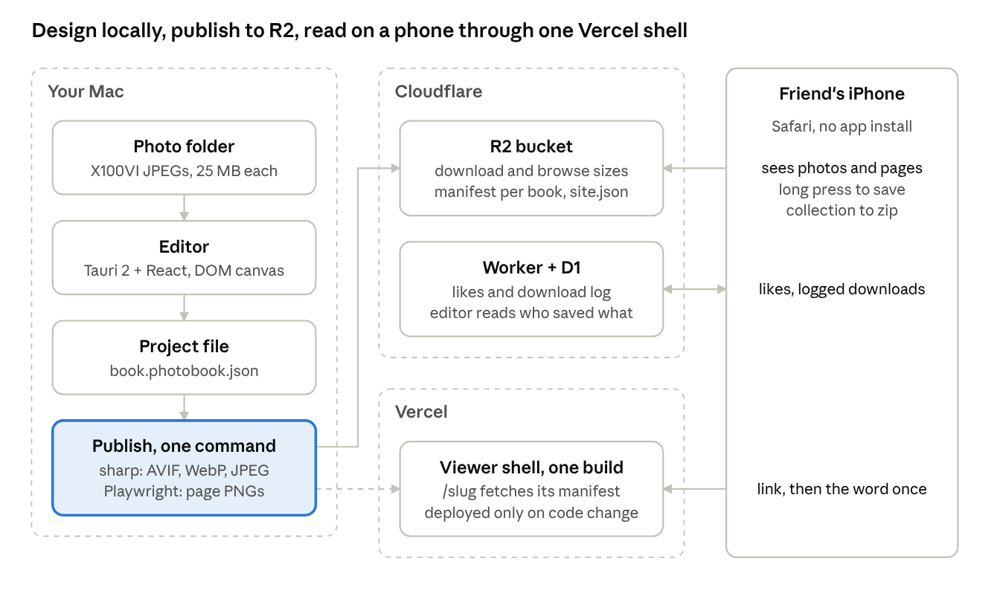

# Photobook

Turn a folder of photos into a designed, zine-style photobook that friends read on their phones.

You design on your computer, against the original files, with page layouts or free-drawn photo boxes and
text. When the book is ready, one command optimizes the images and publishes it to your own cloud storage,
and the book appears at its own link. Friends open the link, type the book's password once if you set one, swipe through
the pages, and save full-quality copies of the photos they like.

Everything is self-hosted: no Photobook account and no central server. You run the editor locally, and
published books live in your own Cloudflare bucket on free tiers.

The editor app is called **oddhalls** (its window title and the macOS app name, `oddhalls.app`); the repository, the
packages and the `photobook` CLI keep the Photobook name, and the app's data stays where it was
(`~/Library/Application Support/com.photobook.editor`).



## Features

**Editor (desktop app)**

- Works on your photo folders in place: import a folder once and it stays in the **Library** sidebar (Folders,
  Collections, Projects). Nothing is copied or uploaded until you publish, so it stays fast with hundreds of large
  camera JPEGs; a small index in `<folder>/.photobook/` makes reopening a folder instant.
- Three stages in the top bar, in the order you work: **Cull · Develop · Design**. Cull and Develop work on a folder
  (or a collection: Picks, Edited) with no project open; Design is a project's canvas. Ratings, flags and edits belong
  to the folder, so a project started later (with all photos, the picks, or none) already has them.
- **Projects**: each book is a project, kept in the app's data folder (or anywhere with **Save as…**) and listed on
  the home screen with its cover. Several projects can use the same folder and share its ratings and edits. A
  `book.photobook.json` left in a folder by an older Photobook becomes a project the first time the folder is seen.
- Book sizes: phone portrait 4:5 (fits a phone screen and Instagram), story 9:16, square, A4 portrait and
  landscape.
- A library of layouts for one to six photos per page, plus custom pages with snapping photo boxes.
- Drag photos from the filmstrip into slots; pan, zoom and rotate inside each slot. The Design stage's left panel
  has the project's photos and a **Library** tab to pull more in from any imported folder.
- One project, several designs: next to the stage tabs, a drop-down switches between the **Book** and the project's
  social **Posts** (each with its own pages and page size) and **Prints** of the book or a post (new, rename, duplicate,
  delete), and **Slideshows** (videos) of either or of your picks.
- **Social posts**: an Instagram carousel, square post or story, a TikTok photo slideshow, a Threads, Bluesky or X set
  or a Pinterest pin, designed on the same canvas with the network's size, frame limit and safe area drawn as guides.
  **Send to post…** copies a book page into a post, fitted to its size. **Export…** writes numbered JPEG or PNG
  frames (`01.jpg … NN.jpg`) and a `caption.txt` to a folder, rendered like the published page images; nothing is
  posted for you. See [PUBLISHING.md](docs/PUBLISHING.md#social-posts).
- **Print PDF**: a print of the book (or of a post) on A5, A4, US Letter, 8 x 10 in or 8 x 8 in paper, as single pages
  or spreads, with bleed (3 mm by default), optional crop marks and photos at 300 dpi from the full-size edits.
  **Export PDF…** writes one PDF page per page or spread, rendered like the published page images; the **Zine** preset
  is A5 spreads with bleed and marks. See [PUBLISHING.md](docs/PUBLISHING.md#print).
- **Slideshow video**: an MP4 (1080p or 4K, landscape, vertical or square) of the book's pages, a post's frames or
  your picks, with Ken Burns motion, crossfades or dips to black and an optional audio track, for YouTube, Reels and
  TikTok. Every frame is rendered like the page images and encoded with FFmpeg (an LGPL build downloaded in
  Settings → Tools, or your own). See [PUBLISHING.md](docs/PUBLISHING.md#slideshow).
- Cull before you design: the **Cull** stage is a full-window grid (3 to 8 columns) with multi-select and
  Lightroom-style keys that keep (P), reject (X) or rate the whole selection at once; Space opens one photo large
  (**Review**, also R inside a project), **C** puts two photos side by side with linked zoom and pan (**Compare**) and
  **N** tiles the selection or the picks (**Survey**) so you can reject down to one. Filter by name, flag (Kept,
  Undecided, Rejects), stars and *Edited*, and save a filter as a **collection** in the sidebar
  (a collection is a filter, never a copy). A project's own photos have the same grid (Project ▾ → Cull its photos).
- **Groups** in Cull: a burst or a re-shot subject (same camera and lens, seconds apart, alike) is one cell showing
  its suggested best (the sharpest frame without motion blur or clipping), with a stacked edge and a `+N` badge that
  counts the kept and rejected frames. **G** opens a group in place, `,` and `.` step its frame, Cmd+G selects it; C
  compares its frame with the suggested best and N surveys its frames. Filters, search, Cmd+A and the counts always
  work on photos, so nothing is hidden by being grouped. *Group* in the filter bar turns it off; its menu makes
  grouping tighter or looser and merges, splits or ungroups (also on right-click). Groups are computed from the folder
  index; only your merges and detaches are saved, in the folder's library. A camera that writes no subsecond time can
  split a burst at a second boundary, and two cameras never share a group.
- **Decide** (Enter on the Cull grid, or *Decide* in the filter bar): one photo or one burst at a time, two keys, Keep
  (P) or Reject (X), until nothing is undecided. On a burst P keeps the frame shown and rejects the rest; Space looks
  at the sharpest part at 100 %; U takes back the last decision of the pass. The header counts decided photos and kept
  ones against a target (*Target ▾*: keep about N photos, or a share, per folder), and the filter bar shows the same
  decided / total fraction. When every photo is decided the view says *Culled* and the folder gets a ✓ in the sidebar.
  Stars are hidden in the grid until you turn on *Stars* in the filter bar.
- **Lenses** in Cull: *Soft*, *Blown* and *Dark* in the filter bar's *Lens* select, a dim badge on each photo they
  find (hover for the number), and the *Worth a look* collection for any of them. They rank and explain; they never
  flag a photo: to reject what a lens shows, select all (Cmd+A) and press X. Soft is the "Softest 10 % of the folder by
  local sharpness; intentional blur looks the same to this test"; inside a burst, Decide marks the sharpest frame and
  draws each frame's sharpness against it, and right-click offers *Select the group's softer frames*. Blown means more
  than 2 % of the preview clipped (over 5 %: likely blown), leaving out high-key photos and silhouettes, and says *RAW
  headroom* for a RAW, which often recovers; Dark means a median brightness under 10 %, leaving out silhouettes.
- **Deleting photos**: rejects stay in their folder until you ask. *Review rejects…* (Project ▾ on the Cull stage,
  right-click in the Cull grid, or the end of a Decide pass) shows every reject of the folder, whatever the filter;
  U rescues one (it becomes undecided), Cmd+A then U rescues all. *Move N to the Trash…* asks once, with the real
  count and size, and keeps photos placed in a project in the folder unless you untick that. The files, with an
  `.xmp` sidecar of the same name (a RAW+JPEG pair's shared sidecar goes with the last of the pair), go to the macOS
  Trash: Photobook never deletes a photo, and you can put any of them back from the Trash (Put Back in Finder); a
  rescan of the folder then brings it back as an undecided photo. There is no key for it, and it cannot be undone
  from Photobook. A project that used a moved photo keeps it as Missing.
- Text boxes with a curated set of fonts and preset styles (title, caption, date stamp, body).
- **AI captions, with your own key** (optional): ✦ Write on a text box offers three captions in an editorial voice,
  each with alt text, written from the photo and a short project brief (what the book is about, who is in it, the
  voice); Shorter, More specific and Different angle ask again, and Use is one undo step. *Caption this page* writes a
  whole page's captions, and *Caption book…* every page's, with the cost shown first and each page reviewed (Accept,
  Edit, Skip) before anything lands; the alt text they write is published for screen readers. It uses your own Anthropic
  API key (Settings → AI, pay as you go, a few cents a request); only previews and the brief are sent, and only to
  Anthropic. See [ACCOUNTS.md](docs/ACCOUNTS.md#anthropic-optional-for-ai-captions).
- Page reordering, duplicate, undo and redo, autosave, and a phone preview frame.
- Works with JPEG, PNG, HEIC and camera RAW (DNG, CR2, CR3, CRW, NEF, NRW, ARW, SRF, SR2, RAF, ORF, RW2, RWL, PEF,
  SRW, ERF, 3FR, FFF, IIQ, MOS, MEF, MRW, KDC, DCR and X3F; about 870 camera models through `rawler`); RAW files are
  developed by the editor and published as JPEG. Details: [INSTALLATION.md](docs/INSTALLATION.md#supported-photos).
- Colour-managed end to end: embedded profiles are honoured, HEIC is decoded at full bit depth through macOS
  ImageIO, edited photos render in the book's output colour (sRGB or Display P3, with a soft-proof toggle in
  Develop), and wide-gamut photos publish in Display P3. See [PUBLISHING.md](docs/PUBLISHING.md#7-publish).
- Moved photos are relinked automatically by size and content hash, also when they moved into another imported folder.
- A **Downloads** tab that shows who saved which photos and pages.

**Cull keys** (the grid; Review keeps its own keys and Esc goes back to the grid)

| Keys | Grid | Review |
| --- | --- | --- |
| ← → ↑ ↓ | Move the focus; Shift extends the selection | Previous / next photo |
| Home / End | First / last photo | First / last photo |
| 1 to 5, 0 | Rate the selection (the focused photo when nothing is selected); 0 clears | Rate; 0 clears |
| P / X / U | Keep / reject the selection; U makes it undecided | Keep / reject / undecided |
| Shift + a rating or flag key | Inverts *Auto-advance* (one photo only; a batch stays put) | Inverts *Auto-advance* |
| D | Develop the focused photo | Develop this photo |
| Space | Review the focused photo | |
| Enter | Decide: keep or reject the undecided photos one unit at a time, from the focused one | |
| C | Compare the focused photo with the next (or the first two selected); on a group, its frame with the best | |
| N | Survey the selection (the picks when nothing is selected; needs two or more); on a group, its frames | |
| G | Open the focused group in place, or close it | |
| , / . | Previous / next frame of the focused group (wraps) | |
| Cmd+G | Select every photo of the focused group | |
| Esc | Clear the selection | Back to the grid, at the same scroll |
| Click, Shift+click, Cmd+click | Select one, a range (in the current sort), add or remove one | |
| Cmd+A | Select every photo the filters show | |
| J / K, Cmd+− / Cmd+= | Smaller / bigger thumbnails | |
| Cmd+Shift+C, Shift+Cmd+Alt+C | Copy the focused photo's develop settings (with Alt: choose the sections) | |
| Cmd+Shift+V, Cmd+Alt+V | Paste settings onto the selection (or the focused photo); with Alt, from the photo before | |
| Cmd+Shift+E | Export the selection (or the focused photo) as new files | Export the selection (or this photo) |
| Right-click | Copy, paste settings, reset edits, export the selection; merge, split or detach groups | |

**Decide keys** (Enter on the grid; a unit is a single photo or a group; Esc goes back to the grid)

| Keys | Single photo | Group |
| --- | --- | --- |
| P | Keep, advance | Keep the shown frame, reject the group's other undecided frames, advance to the next unit |
| Shift+P | Keep, stay | Keep the shown frame only and step to the group's next undecided frame (two keepers from one burst) |
| X | Reject, advance | Reject the shown frame and step inside the group; the last undecided frame rejected advances |
| Shift+X | Reject, advance | Reject every undecided frame of the group, advance |
| U | Undo the last decision of this pass (not app undo) | Same |
| , / . | | Previous / next frame of the group (the strip under the picture) |
| ← → | Previous / next unit without deciding (the counter does not move) | Same |
| Space | 100 % at the sharpest region; again to fit | Same |
| C | | Compare the shown frame with the group's suggested best (Cmd+Enter promotes, Esc back to Decide) |
| D | Develop this photo | Same |
| Esc | Back to the grid, focused on the unit left | Same |

After 45 minutes or 300 decisions a one-line *Good place to stop?* appears above the key hint; it never takes the
focus and *Dismiss* hides it for the pass.

**Compare keys** (C on the grid; the left photo is the candidate, the right one the select)

| Keys | Does |
| --- | --- |
| ← → ↑ ↓, Home / End | Step the candidate through the list shown (the select stays; it is skipped) |
| Cmd+Enter | The candidate becomes the select, and the next photo that is neither is the candidate (at the end of the list, the nearest one before) |
| Tab, click a pane | Which pane the rating and flag keys act on |
| 1 to 5, 0, P / X / U | Rate or flag the focused pane (*Auto-advance* steps the candidate) |
| K / J, Cmd+= / Cmd+− | Zoom both panes through Fit, 1×, 2×, 4× (1× is one pixel of the 1600 px proxy per screen pixel, so half the CSS size on a 2× display; zoom waits until both previews are ready) |
| Shift+F | Fit both panes |
| F / Z / O | Assist: focus peak, zebra, the composition guides (O cycles thirds, golden ratio, phi spiral, centre cross, diagonals); also in One and Decide, and in the header's *Assist* ▾. They never flag a photo |
| Click, drag | A click zooms to 1× at that point on both panes (a second click fits); drag pans both |
| D | Develop the focused pane's photo |
| Esc | Back to the grid, focused on the candidate |

**Survey keys** (N on the grid)

| Keys | Does |
| --- | --- |
| ← → ↑ ↓, Home / End | Move the focus between tiles |
| X | Reject the focused photo (or the marked ones) and remove it from the view; the last one refuses |
| 1 to 5, 0, P / U | Rate or flag the focused (or marked) photos |
| Click, Shift+click | Focus a tile; mark or unmark it |
| D | Develop the focused photo |
| Esc | Back to the grid with the survivors selected |

**Design canvas keys and gestures** (the Design stage)

| Keys | Does |
| --- | --- |
| Drag a frame | Move it, snapped to margins, the grid and other frames (hold Cmd to skip snapping); the first move on a layout page makes it custom and says so, with Undo |
| Drag a frame of a multi-selection | Move the whole selection, snapped as one block (equal spacing too); the toolbar above it aligns, distributes, matches sizes and tidies the gaps |
| Double-click a photo, or Adjust in its toolbar | **Adjust photo**: drag pans the photo inside the frame, the wheel or a pinch zooms it; Esc or a click outside finishes |
| Space + drag | Pan the selected photo once, without entering Adjust photo |
| Alt + drag a photo | Move the photo to another frame (swaps with what is there) |
| Drag a handle | Resize; Shift inverts the frame's ratio lock (frees a locked frame such as a photo, keeps the ratio of a free one such as a text box), Alt resizes from the centre, Cmd skips snapping |
| ← → ↑ ↓, Shift + arrows | Nudge the selection one grid step (ten with Shift); a single frame snaps along the step and the guides flash; with nothing selected, ← → change page |
| Double-click a text box, Enter | Edit the text |
| Drag from a ruler | Pull out a guide onto the page (top ruler: horizontal, left ruler: vertical); frames snap to it. Drag a guide to move it (or focus it and use the arrow keys, 0.01 in, Shift 0.1 in), off the page to remove it, Esc cancels; double-click it (or Enter) to type its position, Delete removes a focused one. View ▾ shows or hides the rulers, snapping and the guides drawn while dragging |
| V / F, T | Select / Frame tool, add a text box |
| Esc | Leave Adjust photo, then the Frame tool, then clear the selection |

**Develop (photo editing)**

Open the **Develop** stage on a folder, or press **D** on a photo of a project, for a non-destructive, Lightroom-style
editor. The edits are stored per
photo in the photo folder's library (so every project on that folder shares them), the original is never written, and
a published book contains the edited renders. Guide:
[docs/DEVELOP.md](docs/DEVELOP.md).

- Seven cards in the order you work (Crop, Light, Color, Detail, Sharpen & denoise, Effects, Masks) and one
  **Basic ⇄ Advanced** switch: Basic shows the common rows, a ▸ opens the rest in place and tags it ·edited when
  changed; Advanced shows everything. **Before / After** flips, splits or shows the two side by side (Y).
  **Apply to all** puts the Light and Color of one photo on the selection, or on the whole strip.
- Light, white balance (as shot, or Kelvin and tint for RAW), tone curves with presets (Soft S, Strong S, Matte,
  Faded, Reverse S), colour mix, vibrance and saturation.
- Crop with aspect presets, straighten, and perspective: manual sliders, guided and automatic Upright.
- Texture, clarity, dehaze, sharpening, and AI denoise.
- Color grading wheels (Shadows, Midtones, Highlights, and a Global wheel) with a luminance slider each, a harmony
  lock (complementary, triadic, analogous, ...) that turns the wheels together, and presets (Teal & orange, Warm/cool
  split, Bleach, Golden, Moody blue, Pastel); vignette, halation and grain.
- Local masks: brush, linear and radial gradients, luminance and colour range, and AI masks for subject, sky,
  background, people (one per person) and depth, with click-to-refine.
- Presets, sync to many photos, and import of Lightroom `.xmp` settings.
- Looks with an Amount slider: twelve built-in looks named after birds (warm and cool negative, chrome, slide, cine
  print, pushed black and white, and more; see [DEVELOP.md](docs/DEVELOP.md#built-in-looks)), your own, and 3D LUTs.
- Copy and paste settings: choose the sections (Shift+Cmd+Alt+C), copy (Cmd+Shift+C), paste onto every selected photo
  in Develop or the Cull grid in one undo step (Cmd+Shift+V), or paste from the previous photo (Cmd+Alt+V). The copy
  sits on the system clipboard, so it works across projects and after a restart.
- **Export** developed photos as new files (Cmd+Shift+E, the batch bar, or right-click in Cull or the sidebar): presets
  for Social (2048 px), Web (1600 px) and Full quality, or your own; JPEG, PNG or WebP, output sharpening for screen,
  file naming with `{name}`, `{seq}`, `{date}` and `{rating}`, into `Exports/<preset>/` next to the photos or any folder.
  Encoded files are cached, so exporting again after editing three photos encodes three. See
  [DEVELOP.md](docs/DEVELOP.md#export).
- Runs on the GPU with a CPU fallback; the AI models are downloaded on demand into the app's data folder
  (**Settings → Models**), run locally, and are all MIT or Apache-2.0.

**Publishing**

- One command or one button: generates AVIF, WebP and JPEG sizes, a full-quality download copy of each
  photo, and Instagram-ready page images, then uploads them to Cloudflare R2.
- Republishing uploads only what changed.
- Listed books appear on the site's home page; unlisted books are reachable by link only.
- An optional soft password per book, typed once per device.

**Viewer (mobile web)**

- One page per screen, swipe to turn, thumbnail grid to jump, works in iOS Safari without an install.
- A drawer with the photos on the current page: view, download in full quality, like.
- Collect favorites across pages and download them as one zip.
- Share a page as a 4:5 feed or 9:16 story image.

## Quick start

You need Node 22+, pnpm 11, Rust 1.89 or newer and CMake. Full instructions: [docs/INSTALLATION.md](docs/INSTALLATION.md).

```bash
git clone https://github.com/jpaulfernandez/gallery-30.git
```

```bash
cd gallery-30 && pnpm install
```

```bash
pnpm dev
```

The first run compiles the native side and takes a few minutes (the first Rust build also downloads ONNX Runtime
once, so it needs network access). Then click **Import folder…**, choose a folder of photos, and start a book
with **New project…**.

## Sharing books on the web

Designing books needs no accounts. To publish them, you set up once:

1. A **Cloudflare** account with an R2 bucket for images (free tier).
2. The **viewer** on Vercel (free Hobby plan) or any static host.
3. Optionally, a small Cloudflare **Worker** for likes and the download log.

What each account is for and what it costs: [docs/ACCOUNTS.md](docs/ACCOUNTS.md).
Step-by-step setup: [docs/PUBLISHING.md](docs/PUBLISHING.md).

## Documentation

| Document | What's in it |
| --- | --- |
| [docs/INSTALLATION.md](docs/INSTALLATION.md) | Prerequisites, running the editor, building the app |
| [docs/ACCOUNTS.md](docs/ACCOUNTS.md) | Which accounts you need, what they cost, where secrets live |
| [docs/DEVELOP.md](docs/DEVELOP.md) | The Develop module: editing photos, masks, AI models, Lightroom import |
| [docs/PUBLISHING.md](docs/PUBLISHING.md) | R2, viewer, settings, publishing, likes and downloads |
| [worker/README.md](worker/README.md) | The likes and download-log API |
| [CONTRIBUTING.md](CONTRIBUTING.md) | Development workflow and code conventions |
| [docs/design/](docs/design/) | The original product requirements, implementation plan and UI notes |

## Repository layout

| Path | What |
| --- | --- |
| `apps/editor` | The desktop editor: Tauri 2, React 19, Vite, Tailwind, TanStack Router, Zustand (Develop UI in `src/components/develop`) |
| `apps/viewer` | The web reader: Vite and Preact, about 60 KB gzipped |
| `apps/site` | The landing page at [gallery30.janpaulfernandez.com](https://gallery30.janpaulfernandez.com): static HTML on Vercel |
| `crates/develop` | The develop pipeline in pure Rust: decode, colour, geometry, masks, GPU, AI models, Lightroom XMP; used by the editor's native side |
| `packages/shared` | Book schema (Zod), migrations, layouts, page renderer and fonts, shared by all apps |
| `packages/publish` | The `photobook` CLI: image processing (sharp), page rendering (Playwright), upload to R2 |
| `worker` | Cloudflare Worker and D1 database for likes and the download log |
| `scripts` | Developer utilities, such as a sample photo generator |

## Status

Photobook started as a personal tool and is shared as is. It works end to end on macOS. Known gaps:

- No prebuilt downloads; you build the editor from source.
- Linux and Windows builds are untested.
- A standalone app build does not bundle the publish CLI yet; publish from `pnpm dev` or see
  [INSTALLATION.md](docs/INSTALLATION.md#4-build-a-standalone-app-optional).
- The custom book size is not available in the editor yet.
- Develop is "Lightroom-like, not identical", has no lens corrections, and its Subject mask runs on the CPU (about 6
  seconds a photo). See [docs/DEVELOP.md](docs/DEVELOP.md#limits-and-caveats).
- Book passwords are a soft gate, not real security.

Issues and pull requests are welcome.

## License

[MIT](LICENSE). The bundled fonts (Inter, Fraunces, Instrument Serif, JetBrains Mono) are licensed under
the SIL Open Font License 1.1; see `packages/shared/fonts/licenses/`.
