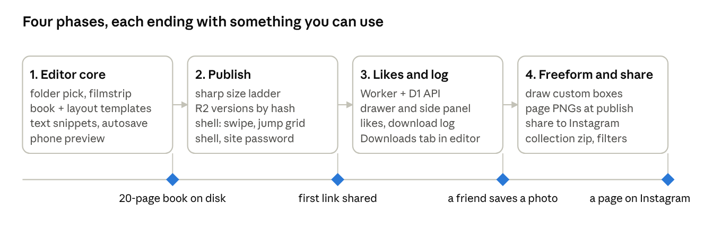

# Photobook PRD

Oct 5, 2026 · The original product requirements, kept for context. Some details changed during the build; the code is the source of truth.

## Summary

Photobook is a personal, local-first tool for turning a folder of photos into a designed, zine-style photobook that friends read on their phones. You design on your Mac against the original files, with page templates (one to six photos per page, landscape or portrait, 3:2 and 4:3) or free-drawn photo boxes plus text snippets. When a book is ready, one command optimizes the images and uploads them with the book's manifest to Cloudflare R2, and the book appears at its own path on one shared domain.

Viewers get a mobile-first reader: one page per screen, swipe to turn, a thumbnail grid to jump, and on a large screen the page centered with a side panel. A drawer shows the photos on the current page, where they can download a full-quality copy, add favorites to a collection and download it as a zip, export the page for Instagram, and tap like. Viewers type one shared soft password the first time they open any link on a device, and give a display name once, so you can see who saved what. Listed books appear at the domain root; unlisted ones are reachable by link only.

**Flow:** pick a folder → design pages locally → publish (optimize → R2) → share the link and the word → friends read, save, collect, like → you see who saved what.

## Goals and non-goals

Success is a book that goes from folder to shared link in one evening, and friends who actually open it, save a few photos, and a Downloads tab that shows you who did.

**Goals**

- Design against original files on disk, with no upload before publish, so the editor stays fast with hundreds of 25 MB camera JPEGs.
- Templates cover 80% of pages in two clicks; the custom box tool covers the rest.
- Publish is one command and under 10 minutes for a 60-page book. Republishing touches only what changed, and a re-crop touches only the manifest.
- Any number of books live under one domain. Listed ones appear at the root; unlisted ones are reachable by link only.
- One soft password for the whole site, typed once per device, then never again until you change it.
- The reader loads fast on a phone over mobile data and works in iOS Safari without an app install.
- Downloads are a full-quality compressed copy of the uncropped photo, about 3 MB, never the 25 MB camera file and never a cropped or page-optimized version.
- Viewers can save a photo in at most two taps, and can collect favorites across pages into one zip download.
- Viewers can export a page as an Instagram-ready image.
- Likes and downloads need only a display name, so you can see who saved what.
- Total hosting cost stays inside free tiers for a few books.

**Non-goals**

- Real security. The soft password is checked in the browser and keeps casual visitors out; anyone with the link and the word gets in, and image URLs on R2 are reachable directly. That is the intended level.
- Multiple designers, accounts, roles, or collaboration in the editor.
- Print or PDF output. Page sizes borrow print proportions for feel only.
- Video, music, or animations beyond page transitions.
- A test suite beyond a few smoke checks on the publish pipeline. This is a personal tool.

## Users and scenarios

Two roles, one person in the first and a small circle in the second.

| Role | Who | Device | Key moments |
| --- | --- | --- | --- |
| Designer | You | Mac, large screen, mouse or trackpad | Point at a folder after a trip; drag photos into templates; write a caption; preview on a phone frame; hit publish; paste the link and the word into a group chat; later, see who saved what |
| Viewer | Friends and family, 5 to 30 people per book | iPhone, Safari, often on mobile data; sometimes a laptop | Open the link from chat; type the word once; swipe through pages; jump to a page from the grid; open the drawer and save a favorite in full quality; add photos to a collection and download the zip; export a page for an Instagram story; tap like |

**Designer scenarios**

1. Import: open the app, choose a folder, see a filmstrip of every image with thumbnails generated locally. Images are referenced in place, never copied.
2. Build a page: pick a book template, add a page, pick a layout (one to six slots), drag photos from the filmstrip into slots, pan and zoom inside each slot.
3. Freeform page: draw boxes by hand, snap to a grid, drop photos into them, add text snippets.
4. Review: scrub through the book in phone preview mode; reorder pages by dragging.
5. Publish: enter a slug, choose listed or unlisted, run publish, get a link. The site password is set once in app settings and can be changed any time. Republishing after an edit only re-uploads changed images and rewrites the manifest.
6. Downloads: open the Downloads tab to see who saved which photos and pages, by self-reported name, newest first.

**Viewer scenarios**

1. Open the link, type the shared word once, land on the cover, swipe to page one. On a laptop the page sits centered with the drawer as a side panel.
2. Swipe or tap through pages, one per screen. Tap the page counter to jump from a thumbnail grid.
3. Pull up the drawer to see the photos on this page as a strip. Tap one for full view, download it in full quality, or like it. The first download asks for a name, once.
4. Add photos to the collection while reading. At the end, download the collection as a zip, or step through it saving each to Photos.
5. Share this page: get a 4:5 or 9:16 image of the page to post to Instagram.
6. Come back later; no password prompt, and the book reopens on the last page read.

## System architecture

Nothing leaves your Mac until you publish. The editor works on files in place and writes one project file; publish turns that into optimized images, page PNGs and a manifest on R2. One viewer shell on Vercel serves every book by path and fetches the right manifest from R2, so publishing a book never redeploys the site. Friends load the shell from Vercel, images from R2, and talk to a Cloudflare Worker for likes and the download log.


The solid arrow from the publish step is the only write per book; the dashed one to Vercel runs only when the viewer code changes. The phone only reads, except for likes and download events going to the Worker, which the editor reads back.

## Designer experience

The editor is a page-based canvas: a book is an ordered list of pages, each page has a fixed size from the book template, and each page holds photo boxes and text boxes. Layout templates are just presets of boxes.

**Book templates (page size)**

Because viewers read on phones, the default book template is portrait 4:5. It fills an iPhone screen and exports to Instagram with no cropping.

| Template | Ratio | Feels like | Notes |
| --- | --- | --- | --- |
| Phone portrait (default) | 4:5 | Instagram feed post | Fits phone screen; exports 1080 x 1350 |
| Story | 9:16 | Instagram story | Tall; exports 1080 x 1920 |
| Square | 1:1 | 8 x 8 in photo book | Classic album feel |
| A4 portrait | 1:1.414 | 210 x 297 mm book | Zine feel; letterboxed on phone |
| A4 landscape | 1.414:1 | 297 x 210 mm book | Shown one page per screen, rotated hint or pinch zoom |
| Custom | any |  | Enter width and height in pt |

**Layout templates (slots per page)**

Each layout is a set of slots with a margin and gutter setting. Slots accept any photo; the photo is cover-fit and can be panned and zoomed inside the slot. Each layout has a variant for landscape-heavy and portrait-heavy photo sets.

| Photos | Layouts |
| --- | --- |
| 1 | Full bleed; framed with margin; offset with caption space |
| 2 | Side by side; stacked; one large plus one small |
| 3 | One hero plus two small (L shape); three-column strip; three rows |
| 4 | 2 x 2 grid; one hero plus three in a column; filmstrip row plus one wide |
| 5 | One hero plus four small (2 x 2); two-over-three |
| 6 | 2 x 3 grid; 3 x 2 grid; one hero plus five small |

Slot aspect ratios offered in the inspector: 3:2, 4:3, 1:1, 4:5, and their portrait counterparts 2:3 and 3:4. Changing a slot's ratio keeps its center and resizes within the layout grid.

**Custom layout**

- Draw a box by dragging on an empty page. Boxes snap to a configurable grid (default 8 pt) and to other box edges and page margins.
- Resize from corners with optional ratio lock; move with drag or arrow keys; reorder z-index.
- Save a custom arrangement as a reusable layout template for this book.

**Photos**

- Filmstrip panel lists every image in the chosen folder and subfolders, with locally generated thumbnails and a used/unused badge.
- Drag from the filmstrip to a slot. Drop onto an occupied slot to swap.
- Per-photo: pan, zoom, rotate 90 degrees, simple filters (black and white, slight fade). No heavy editing.
- Full-resolution preview on demand; the canvas renders a mid-size proxy for speed.

**Text snippets**

- Text box with font (a curated set of four to six families), size, weight, alignment, color, optional background pill.
- Preset styles: title, caption, date stamp, body. Baselines snap to the grid so captions line up across pages.
- Per-page hidden notes for the designer that never publish.

**Page operations**

- Add, duplicate, delete, reorder by drag in a page strip at the bottom.
- Background color or a photo as full-bleed background behind slots.
- Phone preview mode shows the page inside an iPhone frame at real proportions.
- Undo and redo, autosave of the project file on every change.

**Canvas editing model**

The canvas is a React component tree rendered to the DOM, not a raster canvas. Pages are plain positioned divs; this keeps text crisp, makes the viewer and the editor share the same renderer, and lets the publish step render the same page component to a static image. See Recommended tech stack for the alternatives considered.

## Layout research findings

Photobook layout guides agree on a small set of rules: one focal point per spread, consistent margins and gutters, and alternating hero pages with quiet grids. The template list above is built from these.

**Template families used by photobook services** ([Mixtiles layout templates](https://mixtiles.com/blog/photo-books/photo-book-layout-templates))

| Family | Photos per page | Use |
| --- | --- | --- |
| Full-bleed hero | 1 | Impact pages, openers, portraits |
| Clean grid | 2, 4 or 6 with even gutters | Story pages, events |
| Photo and caption | 1 to 2 with a text block | Context, dates, places |
| Diptych or triptych | 2 or 3 side by side | Sequences, before and after |
| Timeline | 4 to 8 small along a line | Chronology of a day |
| Collage with white space | 3 to 6 mixed sizes, one dominant | Travel, parties |

The same guide puts story pages at 3 to 6 images and warns that 7 to 12 only works when subjects are simple and cohesive. That is why the layout picker stops at 6.

**Spacing conventions** ([Leather Craftsmen via SmartAlbums](https://help.smartalbums.com/article/826-designing-a-leather-craftsmen-book), [Queensberry on gutters](https://www.queensberry.com/blog/press-book-margins))

- Print safe zone is about 0.5 in (12 mm) from the trim; minimum margin about 0.25 in (6 mm); bleed 3 mm. On screen there is no trim, so Photobook uses a default outer margin of 4% of the short side and a gutter of 2%, both adjustable per book.
- Keep caption baselines consistent across pages; the editor snaps text to the grid for this reason.
- Spreads in print lose content in the center fold. Photobook shows one page per screen on phones, so there is no fold. Spread mode is a later idea.

**Page sizes** ([Shutterfly photo album sizes](https://www.shutterfly.com/ideas/photo-album-sizes/))

- Square 8 x 8 in is the common choice for everyday and Instagram-style books; 10 x 10 and 12 x 12 for weddings and coffee-table books.
- Portrait 8 x 11 in is the family-album standard; landscape 11 x 8 in suits travel and panoramas.
- A4 is 210 x 297 mm. The A4 book template uses this ratio.

**Instagram export targets** ([Hopper HQ Instagram dimensions](https://www.hopperhq.com/blog/correct-instagram-dimensions/))

| Target | Pixels | Ratio |
| --- | --- | --- |
| Feed portrait | 1080 x 1350 | 4:5 |
| Feed square | 1080 x 1080 | 1:1 |
| Story | 1080 x 1920 | 9:16 |

A 4:5 page exports to feed portrait with no padding. Any other page ratio is placed on a background color inside the target frame.

**What to borrow from Canva-style editors**

- Templates as the entry point, with a blank page as a secondary option.
- Smart guides and snapping; alignment and distribute commands.
- A layers list for z-order on custom pages.
- Element-level inspector on the right, page strip on the bottom, assets on the left.

## Viewer experience

The reader is a static, mobile-first web page per book. Pages fill the screen one at a time, and everything social lives in a bottom drawer so the page itself stays clean.

**Access**

- One soft password for the whole site, set in the editor settings. Publish stores a salted hash and a version number in `site.json` on R2, next to the list of listed books.
- First open of any link, root or book: the shell reads `site.json` and checks local storage for an access flag carrying the current password version. No flag, or an old version: it shows the password field over a blurred cover. A correct word stores the flag, and that device never sees the prompt again until you change the word or an optional expiry date passes.
- Root with access: more than one listed book shows the list by cover and title; exactly one redirects straight to it; none shows a blank page.
- Unlisted books, marked in the editor, never appear in `site.json` or the list. They are reached by their link and need the same word once. Unlisted slugs get a random suffix by default.
- Each book lives at `https://<domain>/<slug>`. Image URLs on R2 carry a random per-book prefix; they are public but not listable.

**Reading**

- Always one page per screen, the way a printed book is read. Horizontal swipe turns the page with scroll snapping; tap the left or right edge to step. No vertical feed and no infinite scroll.
- Page turn is a plain horizontal slide with a short ease, about 250 ms, and no curl.
- A page counter at the bottom ("12 / 48") opens a thumbnail grid of every page for jumping; tapping a thumbnail closes the grid on that page. The URL carries the page number, so a link can point at a page.
- The browser remembers the last page read per book in local storage, so the book reopens where they left off, on any screen size.
- On screens wider than about 900 px the page sits in a centered container at its own ratio, and the extra width on the right holds the drawer content as a permanent side panel. Keyboard arrows turn pages.
- A page is rendered as the same component tree the editor uses, so what you designed is what they see. Fonts are self-hosted.
- Images load through a `picture` element with AVIF, WebP and JPEG sources and `srcset` sizes, with a blurred tiny placeholder to avoid layout shift. Adjacent pages preload.
- Pinch to zoom on a page; double tap to reset.
- Landscape books letterbox on a portrait phone with a rotate hint.

**Drawer**

- Swipe up from the bottom handle, or tap the photos badge, to open a sheet listing the photos on this page as square thumbnails, plus the page's like count.
- Tap a thumbnail to open the full photo in a lightbox with its own actions: Download, Share, Add to collection, Like.
- On a large screen the same content is the side panel next to the page, always open.

**Save a photo to iPhone Photos**

Safari gives no direct API to write to the Photos library, and the Web Share API's share sheet has dropped its "Save Image" option for shared image files since iOS 16.2, with the WebKit bug still open ([WebKit 255544](https://bugs.webkit.org/show_bug.cgi?id=255544), [Apple Developer Forums](https://developer.apple.com/forums/thread/729782)). The reliable path is the native long press.

1. The lightbox shows the photo uncropped, from the 2048 px share version, so it opens fast on mobile data. The full-size `img` has nothing overlaid on it.
2. Download swaps in the download version, a full-quality compressed copy of about 3 MB. On iPhone it then shows a one-time hint, "press and hold the photo, then Add to Photos"; on other devices the file saves directly through an anchor with the `download` attribute. A screenshot of the page is fine too.
3. Share hands the share version to `navigator.share`, which opens the system sheet for AirDrop, Messages, and Instagram.
4. The first Download or Share asks for a display name once per device. Each Download, Share and zip is logged with that name. The long press itself happens inside Safari and cannot be observed, so the log records the Download tap as the save.

**Collection and zip download**

A collection is a per-device shortlist of photos a viewer wants to keep. Friends pick as they read and download once at the end.

- Every photo in the drawer and lightbox has an Add to collection toggle. A badge in the header shows the count and opens the collection view.
- The collection view lists the chosen photos across pages, with remove, Clear all, Share all, and Download zip. It shows the zip size up front.
- The zip holds the download versions, built in the browser with fflate straight from R2 and streamed so a 40-photo collection of about 120 MB stays within memory limits. R2 needs a CORS rule allowing the book domain.
- On iPhone the zip lands in Files, not Photos. The collection view says so and offers Save one by one: a lightbox that steps through the download versions so each can be long-pressed into Photos.
- Share all hands every file to the system share sheet, which is the quick way to AirDrop a whole collection to a Mac.
- The collection itself lives in local storage; the zip download is logged with the display name and the list of photos.

**Share a page to Instagram**

There is no web intent to post to Instagram, so the flow is image first, then Instagram.

- Each page is pre-rendered at publish time to two PNGs: 1080 x 1350 (feed) and 1080 x 1920 (story). Non-4:5 pages sit on the page background color inside the frame.
- A "Share page" button in the drawer offers Feed or Story, then calls `navigator.share` with that PNG. Instagram appears in the share sheet on iPhones with the app installed; the user picks it and the image lands in the composer.
- Fallback: open the PNG in the lightbox for a long-press save.
- Pre-rendering at publish avoids DOM-to-image libraries in Safari, which are inconsistent with fonts and cross-origin images.

**Likes and the download log**

No comments. Nothing a viewer types is shown to other viewers; the only text they enter is a display name.

- The first like, download or share asks for a display name, stored in local storage and sent with each event. It is self-reported, so a friend can type anything.
- Like is one tap, toggled, and stored per device identifier so it does not double count on refresh.
- The Worker records download events: book, page, photo, action (download, share, zip, page share), display name, device id, time.
- The editor has a Downloads tab per book: who saved what, newest first, with counts per photo and per page, and a top-photos list.

**Performance targets**

| Metric | Target |
| --- | --- |
| First page visible on 4G | under 2 seconds |
| Page image bytes at phone width | under 250 KB |
| JavaScript shipped to viewer | under 100 KB gzipped |
| Works offline after first view | pages visited, via a service worker (later) |

## Publish pipeline

Publish is one command run from the local app. It is idempotent: re-running after edits only processes and uploads what changed, keyed by content hash.

**Steps**

1. **Freeze the project.** Read the project file, resolve every referenced photo on disk, and compute a SHA-256 of each source file. Crops are not part of the hash, because crops are applied in CSS.
2. **Produce image versions.** For each used photo, emit the versions in the table below: a download copy, a share JPEG, and an uncropped browse ladder in AVIF and WebP with a 24 px blurred placeholder. The 25 MB camera file never leaves the Mac. Quality starting points: AVIF 52, WebP 76, JPEG 82 to 88 ([2026 web image guidance](https://blog.codercops.com/blog/web-images-avif-webp-lcp-optimization-2026)). The download copy keeps EXIF; the others keep only orientation, applied.
3. **Render page images.** Render each page component headless to 1080 x 1350 and 1080 x 1920 PNGs for Instagram sharing, plus a 320 px thumbnail for the jump grid, using the same renderer as the viewer.
4. **Upload to R2.** Put all versions and page PNGs under `books/<slug>/<random prefix>/<hash>.<ext>` with a one-year immutable cache header, skipping keys that already exist. Then write `books/<slug>/manifest.json` and rewrite `site.json` (password hash and the listed books), both with a no-cache header so an edit shows on the next load.
5. **Done.** The viewer shell on Vercel already serves any slug, so publishing a book never deploys anything. The app prints the link and records the publish in the project file.
6. **Viewer shell deploy, separately.** Run `vercel deploy --prod` only when the viewer code itself changes. The shell is one static build with a rewrite from `/:slug` to the app, which reads the slug from the URL and fetches that book's manifest from R2. Vercel Hobby allows 100 deployments per day and 100 MB of source per CLI deployment ([Vercel limits](https://vercel.com/docs/limits)); the shell is a few hundred kilobytes.

**Image versions**

Three versions per photo, plus page images. The source is a Fujifilm X100VI JPEG, 40 megapixels and about 25 MB; it stays on your Mac as the editing master. There is no cropped tier: the slot crop is applied in CSS from the uncropped browse ladder, so each source photo is processed once however many slots use it, and a re-crop in the editor republishes only the manifest.

| Version | What | Format and size | Used for |
| --- | --- | --- | --- |
| Download | Uncropped, 4096 px on the long edge, EXIF kept. Enough for any screen and a sharp A4 print. HEIC input is converted the same way | JPEG quality 88 (mozjpeg), about 2 to 4 MB | Download, zip, Save one by one, long press |
| Share | Uncropped, 2048 px on the long edge | JPEG quality 85, about 0.5 to 1 MB | Lightbox, Share sheet, Instagram photo posts |
| Browse ladder | Uncropped, 480, 960, 1440 and 2048 px on the long edge, plus a 24 px placeholder | AVIF and WebP, about 40 KB to 450 KB each | Pages in the reader, cropped with CSS |
| Page image | The whole page rendered | PNG 1080 x 1350 and 1080 x 1920, plus a 320 px thumbnail | Share page to Instagram, jump grid |

The download size and quality are two settings in the app, so you can go up to full resolution (about 8 MB at quality 88) for a book that deserves it. The cost of CSS cropping is some wasted bytes when a slot zooms deep into a photo; at the usual 1.0 to 1.5x zoom it is small. All versions together are about 5 MB per photo, so a 60-page book with 180 photos is about 1 GB.

**Updating a published book**

- Re-running publish is the whole update story. Unchanged images are skipped by hash, new ones are uploaded, and the manifest is rewritten. A re-crop, a reorder or a caption change publishes in seconds because only the manifest changes.
- Page and photo ids are stable ULIDs in the project file, so likes and the download log stay attached across edits and reorders.
- Image keys no longer referenced by the manifest stay in the bucket by default. A `--prune` flag removes them.
- Changing the site password bumps its version in `site.json`; every device is asked for the new word on its next load. Switching a book between listed and unlisted rewrites `site.json` only.
- Unpublish a book by deleting its R2 prefix; the shell shows a not-found page for that slug.
- Books are independent: publishing one never reads or writes another's prefix, and there is no cap on how many slugs exist.

**Costs at this scale**

| Resource | Free allowance | Expected use |
| --- | --- | --- |
| R2 storage ([R2 pricing](https://developers.cloudflare.com/r2/pricing/)) | 10 GB per month | about 1 GB per book; 10 books fit free, 20 GB would cost about $0.15 per month |
| R2 egress | free | friends viewing and downloading, no cost |
| R2 Class A writes | 1 million per month | a few thousand per publish |
| Vercel Hobby bandwidth | 100 GB per month | HTML and JS only, well under |
| Likes and download log API (Cloudflare Workers) | 100,000 requests per day | hundreds |

Everything fits in free tiers unless books go viral, which is not the goal.

**Failure handling**

- Upload failures retry three times, then the run stops and reports the missing keys; re-running resumes.
- A deploy that fails leaves the previous version live, since Vercel swaps atomically.
- The project file records the last successful publish so the app can show "unpublished changes".

## Data model

One JSON project file per book, stored next to the photo folder, is the single source of truth for the editor. Publish derives a smaller manifest from it. Likes and the download log live in a tiny hosted database.

**Project file** (`book.photobook.json`, autosaved)

```json
{
  "version": 1,
  "id": "ulid",
  "title": "Kyoto, April 2026",
  "sourceFolder": "/Users/me/Pictures/kyoto",
  "template": { "name": "phone-portrait", "width": 1080, "height": 1350 },
  "theme": { "background": "#fff", "fonts": ["Inter", "Fraunces"], "margin": 0.04, "gutter": 0.02 },
  "assets": {
    "a1": { "path": "DSCF1021.jpg", "hash": "sha256...", "width": 6000, "height": 4000 }
  },
  "pages": [
    {
      "id": "p1",
      "layout": "hero-plus-two",
      "background": "#fff",
      "elements": [
        { "type": "photo", "id": "e1", "asset": "a1",
          "frame": { "x": 0.04, "y": 0.04, "w": 0.92, "h": 0.6 },
          "crop": { "x": 0.1, "y": 0, "scale": 1.2 }, "rotate": 0, "filter": "none" },
        { "type": "text", "id": "e2", "text": "Day one", "style": "caption",
          "frame": { "x": 0.04, "y": 0.66, "w": 0.92, "h": 0.05 }, "align": "left" }
      ],
      "notes": "designer only"
    }
  ],
  "publish": { "slug": "kyoto-2026-x7k2", "visibility": "private", "lastPublishedAt": "2026-10-05T10:00:00Z", "r2Prefix": "7f3k9" }
}
```

> Note (Oct 12, 2026): book v8 replaced `sourceFolder` with `folders: Record<id, { path }>` and an asset `folder` id (workflow plan 03); see `packages/shared/src/schema.ts`.

Frames and crops are fractions of the page so the same page renders at any pixel size. Assets are referenced by relative path plus hash, so a renamed or moved file can be re-linked by hash.

**Published manifest** (`manifest.json`, shipped with the site)

- Book id, slug, title, listed flag, template size, theme, published-at time.
- Pages in order, each with elements as above but with `asset` replaced by an image record: `{ "download": { "url", "bytes", "filename" }, "share": url, "avif": [urls by width], "webp": [...], "placeholder": "data:...", "width", "height" }`. The element keeps its `crop`, which the viewer applies in CSS.
- Per page: a thumbnail URL for the jump grid, plus `shareFeed` and `shareStory` PNG URLs.
- No designer notes, no local paths.

**Site file** (`site.json` on R2, rewritten by publish and by a password change)

```json
{
  "password": { "hash": "sha256...", "salt": "...", "version": 3, "expiresAt": null },
  "books": [
    { "slug": "kyoto-2026", "title": "Kyoto, April 2026", "cover": "https://cdn.../cover.avif" }
  ]
}
```

Only listed books appear in `books`. The viewer stores `{ "version": 3, "grantedAt": "..." }` in local storage after a correct entry and compares the version on every load.

**Social records** (hosted, D1 or similar)

| Table | Columns |
| --- | --- |
| likes | book\_id, target\_type (page or photo), target\_id, device\_id, display\_name, created\_at; unique on (target, device) |
| downloads | id, book\_id, target\_type (page, photo or collection), target\_id, action (download, share, zip, page\_share), display\_name, device\_id, created\_at |

The API exposes toggle like, log event, and a list endpoint for the editor's Downloads tab that requires the designer's admin token. A zip event stores the photo ids in its `target_id` as a list. All writes are keyed by book id, which is unguessable but not secret.

## Recommended tech stack

One TypeScript monorepo with three packages: `editor` (local app), `viewer` (static site), and `shared` (page renderer, schema, layouts). The page renderer being shared is the key decision; it means the editor preview, the published site and the Instagram PNGs are the same code.

| Layer | Choice | Why | Alternatives considered |
| --- | --- | --- | --- |
| Local app shell | [Tauri 2](https://v2.tauri.app/plugin/dialog/) | Native folder picker and fast file reads, small bundle, low memory; the Rust side is only used for file access and thumbnails | Electron (heavier, but fine if Rust is a blocker); a plain browser app with the File System Access API (no Safari support and awkward persistence) |
| Editor UI | React, Vite, Tailwind, TanStack Router | Fits the existing skills in this workspace | Svelte |
| Canvas | DOM-based page component with pointer events and a small snapping engine | Crisp text, same renderer as the viewer, no raster round-trip | Konva (good React bindings, but raster text and a second renderer); Fabric.js (same, older API); Polotno (full editor SDK, paid, more than needed) |
| Thumbnails and image processing | [sharp](https://sharp.pixelplumbing.com/) in a Node sidecar, or Rust `image` crate in Tauri | sharp outputs AVIF, WebP, JPEG and is 4 to 5 times faster than ImageMagick | ImageMagick CLI |
| HEIC input | `heic-convert` or `sips` on macOS as a pre-step | sharp does not read HEIC by default; iPhone shots need it | libheif-enabled sharp build |
| Page PNG rendering | Playwright headless Chromium rendering the shared page component | Pixel-faithful to the viewer, handles fonts and images | Satori (no arbitrary CSS), DOM-to-image in the viewer (unreliable in Safari) |
| Image and manifest hosting | Cloudflare R2 with a public custom domain and a CORS rule for the book domain | Free egress, 10 GB free storage; holding the manifest here means a book publish is upload-only | Vercel Blob (egress billed), S3 (egress billed) |
| Site hosting | Vercel, one project serving a viewer shell for every book | Books are paths: a rewrite sends `/:slug` to the shell, which fetches that book's manifest from R2. Publishing a book never redeploys. | Cloudflare Pages (keeps one vendor); one Vercel project per book (rejected: a deploy per book and a domain per book) |
| Likes and download log API | Cloudflare Worker plus D1 | Same account as R2; free tier of 100,000 requests per day and 5 million D1 row reads per day ([Workers limits](https://developers.cloudflare.com/workers/platform/limits/), [D1 pricing](https://developers.cloudflare.com/d1/platform/pricing/)) | Supabase (heavier), Vercel KV |
| Zip download | fflate in the browser, streaming | No server in the path; fetches JPEGs straight from R2 | A Worker that zips on the fly (10 ms CPU limit on the free tier makes this awkward) |
| Viewer | Vite static build, React with minimal client code, or Preact to stay under the bundle target | Small, fast, same component code | Astro islands |
| Fonts | Self-hosted subset of 4 to 6 families | No third-party requests, consistent in PNG renders | Google Fonts |

**Repository layout**

```
photobook/
  apps/editor      Tauri 2 + React, including the Downloads tab
  apps/viewer      the one viewer shell deployed to Vercel
  packages/shared  schema, layouts, page renderer, image URL helpers
  packages/publish CLI: image versions, page renders, R2 upload, books index
  worker/          Cloudflare Worker for likes and the download log
```

The publish CLI runs inside the editor via a button, and also from the terminal for debugging.

## Milestones

Build in four phases, ordered so a real book gets shared after phase 2 and the rest is polish friends will notice. No dates; each gate is a thing you can do, not a deadline.



The MVP is phases 1 and 2: design with templates, publish behind a soft password, swipe through on a phone. Custom boxes come last because templates cover most pages and the box tool is the most fiddly UI to build.

**Phase detail**

1. **Editor core.** Tauri shell with folder picker; filmstrip with cached thumbnails; the 4:5 and square book templates; all layouts for 1 to 6 photos; pan and zoom in slots; text styles; page strip; autosave; phone preview frame.
2. **Publish.** Shared page renderer; image versions with hash skip; R2 upload of versions, manifest and `site.json`; listed or unlisted flag; site password with version; viewer shell on Vercel with the password gate, slug routing, root list and single-book redirect, swipe with slide animation, lightbox, jump-to-page grid, last-page memory, desktop side panel; publish button in the app.
3. **Likes and download log.** Worker and D1 with likes and download events; drawer and side panel; display name prompt; Download in full quality, Share, long-press hint; Downloads tab in the editor.
4. **Freeform and share.** Draw and snap custom boxes; save custom layouts; page PNG rendering with Playwright; Share page to Feed or Story; collection and zip download; black and white and fade filters; A4 and story templates.

## Open questions and risks

**Risks**

| Risk | Impact | Mitigation |
| --- | --- | --- |
| iOS Safari never restores "Save Image" in the Web Share sheet | Saving a photo stays a long-press gesture | Accepted. Show the hint once per device; make the lightbox image large and unobstructed; keep Share for AirDrop and Messages |
| Long-press saves and screenshots are invisible to the page | The Downloads tab undercounts | Accepted. Make Download the obvious button and log its tap as the save; treat the log as a rough picture, not an audit |
| A friend types someone else's name | The log is wrong for that row | Accepted; it is self-reported by design |
| The word gets forwarded with a link | Someone you did not invite reads a book | Change the word in settings; every device is prompted again on next load. Unlisted books also get a new random slug on request |
| Instagram changes how it accepts shared images | Page export flow breaks | Export is a plain PNG in Photos as fallback; nothing depends on an Instagram API |
| RAW inputs from the X100VI | Thumbnails fail | RAW is unsupported in v1; shoot or export JPEG. HEIC from iPhones is converted on import |
| Zip built in the browser runs out of memory | Collection download fails on older iPhones | Stream with fflate; cap a collection at 100 photos (about 300 MB); offer Save one by one |
| Publish of a large book takes long | Friction before sharing | Hash-based skip of unchanged images; parallel uploads; progress bar with per-step timing. Resizing 180 photos of 40 megapixels takes a few minutes with sharp |
| Vercel Hobby is for non-commercial use | Terms issue if the tool ever becomes a product | Fine as a personal tool; Cloudflare Pages is a drop-in alternative |

**Open questions**

- [x] Download size: 4096 px at quality 88 (about 3 MB) as the default, or full 40-megapixel resolution (about 8 MB)? The doc assumes 4096 with a setting to raise it.
- [x] Password expiry: never, unless you change the word (the default here), or a fixed number of days?
- [x] Should the Downloads tab also show likes per photo as a simple popularity list?
- [x] Is a zip cap of 100 photos right, or should big collections split into several zips?
